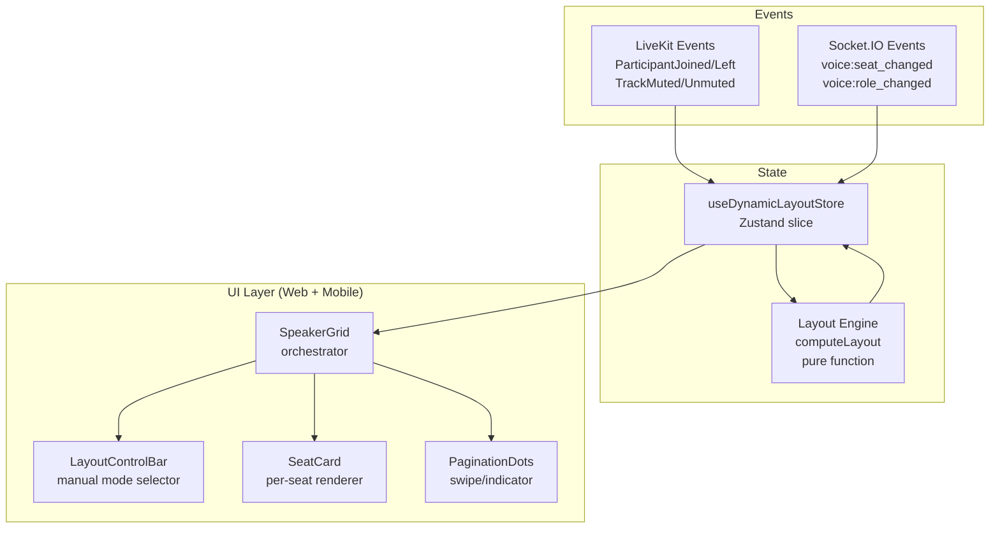
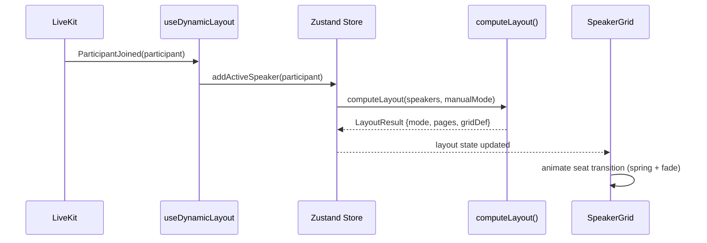
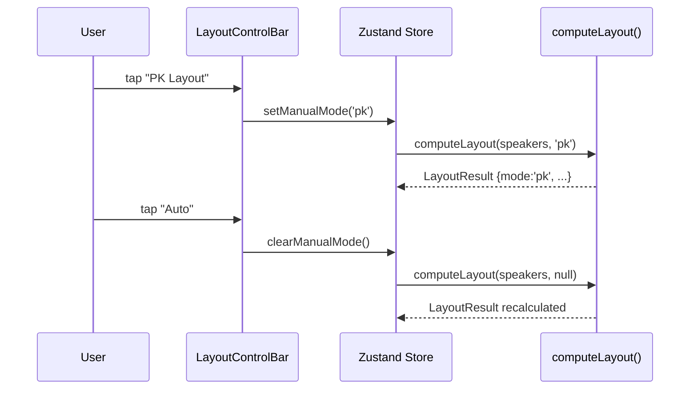
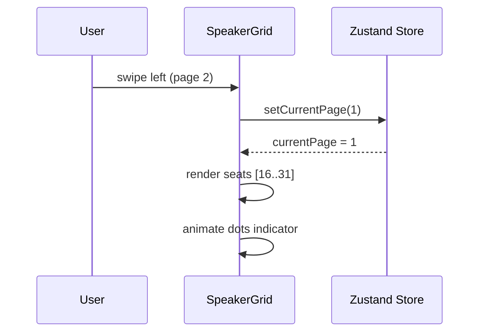

# Design Document: Dynamic Speaker Layout System

## Overview

The Dynamic Speaker Layout System is a fully automatic, production-ready layout engine for HALQA LIVE CLASS that intelligently arranges speaker seats based on the number of active participants. It renders across React Native (mobile/Expo) and Next.js (web), integrating with LiveKit events and the existing Zustand voice store. The system mirrors the premium UX of TikTok Live, Clubhouse, and Discord Stage while remaining optimized for educational voice/video rooms with up to 100+ concurrent speakers and unlimited paginated participants.

The system has two layers: a pure **layout computation engine** (no UI, fully testable) and a set of **presentation components** (SeatCard, SpeakerGrid, LayoutControlBar, PaginationDots) that consume its output. All state is held in an extended Zustand slice and updated reactively on LiveKit and Socket.IO events, guaranteeing instant, flicker-free transitions at 60 FPS.

## Architecture



## Sequence Diagrams

### Auto Layout Switch (Speaker Joins)



### Manual Mode Override



### Pagination Swipe



## Components and Interfaces

### Component Hierarchy

```
SpeakerGrid (orchestrator)
├── LayoutControlBar          — manual mode picker pill
├── PaginatedSeatArea         — handles page state + swipe
│   ├── SpeakerPage           — renders one page of seats
│   │   └── SeatCard[]        — individual seat renderer
│   └── PaginationDots        — page indicator + tap-to-jump
└── GiftOverlay               — floating gift animations (host seat)
```

### SpeakerGrid

The top-level orchestrator. Reads from `useDynamicLayoutStore`, subscribes to LiveKit room events via `useParticipants()` / `useLocalParticipant()`, and drives all child components. No business logic — only wiring.

**Props (Web — React):**
```typescript
interface SpeakerGridProps {
  roomId:        string;
  isHost:        boolean;
  currentUserId: string;
  theme?:        'dark' | 'light' | 'oled';
  className?:    string;
}
```

**Props (Mobile — React Native):**
```typescript
interface SpeakerGridProps {
  roomId:        string;
  isHost:        boolean;
  currentUserId: string;
  theme?:        'dark' | 'light' | 'oled';
  style?:        StyleProp<ViewStyle>;
}
```

### SeatCard

Renders a single seat — occupied or empty. All badge/animation logic lives here.

```typescript
interface SeatCardProps {
  seat:          SeatData;           // see Data Models
  size:          SeatSize;           // { width, height } in px/dp
  isSpeaking:    boolean;
  isMuted:       boolean;
  isCurrentUser: boolean;
  isHost:        boolean;
  layoutMode:    LayoutMode;
  onPress?:      (seat: SeatData) => void;
  onLongPress?:  (seat: SeatData) => void;   // admin actions
  showBadges?:   boolean;                    // false in Minimal mode
  showGifts?:    boolean;                    // false in Minimal mode
}
```

### LayoutControlBar

Horizontal scrollable pill bar. Shows current mode with a badge. "Auto" is always first.

```typescript
interface LayoutControlBarProps {
  currentMode:   LayoutMode;
  isManual:      boolean;
  onSelectMode:  (mode: LayoutMode) => void;
  onResetAuto:   () => void;
}
```

### PaginationDots

```typescript
interface PaginationDotsProps {
  totalPages:    number;
  currentPage:   number;
  onPageSelect:  (page: number) => void;
}
```

### useDynamicLayout Hook

Bridge between LiveKit events and the Zustand store. Used in SpeakerGrid.

```typescript
function useDynamicLayout(roomId: string): {
  layout:       LayoutResult;
  currentPage:  number;
  manualMode:   LayoutMode | null;
  setPage:      (page: number) => void;
  setManual:    (mode: LayoutMode) => void;
  clearManual:  () => void;
}
```

### computeLayout (Pure Engine)

```typescript
function computeLayout(
  speakers:    SpeakerSlot[],
  manualMode:  LayoutMode | null,
  options?:    LayoutOptions
): LayoutResult

interface LayoutOptions {
  pageSize?:         number;   // default 16
  hostAlwaysFirst?:  boolean;  // default true
  prioritizeActive?: boolean;  // default true
}
```

## Data Models

### SpeakerSlot

Represents one occupied or reserved seat in the room.

```typescript
interface SpeakerSlot {
  userId:        string;
  seatIndex:     number;      // 0-based position
  role:          SeatRole;
  displayName:   string;
  avatarUrl?:    string;
  countryCode?:  string;
  level?:        number;
  isVip?:        boolean;
  isMuted:       boolean;
  isSpeaking:    boolean;
  isOnline:      boolean;
  connectionQuality: 'excellent' | 'good' | 'poor' | 'unknown';
  frameUrl?:     string;      // decorative avatar frame
  badgeUrl?:     string;      // role/achievement badge
  isVerified?:   boolean;
  isLocked?:     boolean;     // seat locked by admin
  isReserved?:   boolean;
}

type SeatRole = 'owner' | 'moderator' | 'speaker' | 'empty';
```

### SeatData

The union of slot data with display metadata consumed by SeatCard.

```typescript
interface SeatData extends SpeakerSlot {
  isEmpty: boolean;
  key:     string;   // stable React key = `seat-${seatIndex}`
}
```

### LayoutMode

```typescript
type LayoutMode =
  | 'auto'
  | 'grid'
  | 'focus-host'
  | 'podcast'
  | 'classroom'
  | 'pk'
  | 'compact'
  | 'minimal';
```

### GridDefinition

Describes column/row structure for a given speaker count.

```typescript
interface GridDefinition {
  columns:     number;
  rows:        number;
  hostSpan?:   { colSpan: number; rowSpan: number }; // for focus-host
  seatAspect?: number;   // width/height ratio, default 1
}

// Lookup table (auto mode):
const AUTO_GRID: Record<number, GridDefinition> = {
  1:  { columns: 1, rows: 1 },
  2:  { columns: 2, rows: 1 },
  3:  { columns: 2, rows: 2 },   // host spans top row
  4:  { columns: 2, rows: 2 },
  5:  { columns: 3, rows: 2 },
  6:  { columns: 3, rows: 2 },
  7:  { columns: 3, rows: 3 },
  8:  { columns: 3, rows: 3 },
  9:  { columns: 3, rows: 3 },
  10: { columns: 4, rows: 3 },
  11: { columns: 4, rows: 3 },
  12: { columns: 4, rows: 3 },
  13: { columns: 4, rows: 4 },
  14: { columns: 4, rows: 4 },
  15: { columns: 4, rows: 4 },
  16: { columns: 4, rows: 4 },
};
// > 16: paginate at 16 per page, use 4×4
```

### LayoutResult

The output of `computeLayout()`.

```typescript
interface LayoutResult {
  mode:          LayoutMode;      // resolved (may differ from manual if invalid)
  gridDef:       GridDefinition;
  pages:         SeatData[][];    // pages[0] = first 16 seats, etc.
  totalPages:    number;
  totalSpeakers: number;
  isManual:      boolean;
  pkConfig?:     PKConfig;        // only set in 'pk' mode
}

interface PKConfig {
  teamA:  SpeakerSlot[];
  teamB:  SpeakerSlot[];
  format: '1v1' | '2v2' | '3v3' | 'club';
}
```

### DynamicLayoutState (Zustand slice)

```typescript
interface DynamicLayoutState {
  // Seat data (source of truth)
  speakers:       SpeakerSlot[];
  
  // Computed (derived by computeLayout on every mutation)
  layout:         LayoutResult;
  
  // User preferences
  manualMode:     LayoutMode | null;
  currentPage:    number;
  
  // Admin
  lockedSeats:    Set<number>;
  reservedSeats:  Set<number>;
  pinnedUserId:   string | null;
  
  // Actions
  addSpeaker:     (s: SpeakerSlot) => void;
  removeSpeaker:  (userId: string) => void;
  updateSpeaker:  (userId: string, patch: Partial<SpeakerSlot>) => void;
  setSpeakers:    (speakers: SpeakerSlot[]) => void;
  setManualMode:  (mode: LayoutMode) => void;
  clearManualMode:() => void;
  setCurrentPage: (page: number) => void;
  pinSpeaker:     (userId: string | null) => void;
  lockSeat:       (seatIndex: number, locked: boolean) => void;
  reserveSeat:    (seatIndex: number, reserved: boolean) => void;
  swapSeats:      (indexA: number, indexB: number) => void;
}
```

### Theme Tokens

```typescript
interface LayoutTheme {
  bg:             string;   // '#0f0f23'
  card:           string;   // '#1a1a2e'
  cardBorder:     string;   // '#2d2d4e'
  primary:        string;   // '#4f46e5'
  accent:         string;   // '#a5b4fc'
  speaking:       string;   // '#10b981' (glow color)
  muted:          string;   // '#ef4444'
  empty:          string;   // '#374151'
  shadow:         string;
  blur:           boolean;
  glassmorphism:  boolean;
}
```

## Algorithm Design

### computeLayout() — Step-by-Step

```
INPUT:  speakers[], manualMode, options

1. SORT speakers
   a. owner  → index 0 (always first/top-left)
   b. moderators → indices 1..n sorted by seatIndex
   c. active speakers (isSpeaking && !isMuted) → next, sorted by activity; an actively speaking regular participant ranks above a muted moderator
   d. muted speakers → last

2. IF pinnedUserId is set → move that speaker to index 1 (right of host)

3. DETERMINE effective mode
   - If manualMode is set AND valid for count → use manualMode
   - Else → resolve AUTO_GRID by speaker count

4. DETERMINE gridDef from mode
   - 'auto'        → AUTO_GRID[clamp(count, 1, 16)]
   - 'focus-host'  → host gets colSpan=2/rowSpan=2, rest 1×1
   - 'podcast'     → columns=2, rows=3, max 6 speakers shown
   - 'classroom'   → host top full-width (hostSpan), students 4×n
   - 'pk'          → split: teamA left, teamB right (build PKConfig)
   - 'compact'     → fixed small cards, columns=4+ regardless of count
   - 'minimal'     → same grid as auto but no badges/gifts in output
   - 'grid'        → force square grid regardless of count

5. BUILD pages
   pageSize = options.pageSize ?? 16
   pages = chunk(sortedSpeakers, pageSize)
   Fill last page with empty SeatData to complete the grid

6. RETURN LayoutResult
```

### Seat Sizing Algorithm (Mobile)

```
screenWidth  = Dimensions.get('window').width
screenHeight = availableHeight  (total - tabBar - controlBar)

// For columns × rows grid:
seatWidth  = (screenWidth  - (columns+1) * GAP) / columns
seatHeight = min(seatWidth * aspectRatio, (screenHeight - (rows+1)*GAP) / rows)

// In focus-host mode, host occupies (columns/2) width slots
hostWidth  = seatWidth * hostSpan.colSpan + GAP * (hostSpan.colSpan - 1)
hostHeight = seatHeight * hostSpan.rowSpan + GAP * (hostSpan.rowSpan - 1)
```

### Speaking Animation State Machine

```
IDLE ──→ SPEAKING ──→ IDLE
          │
          ↓
      PEAK (brief scale burst when audio peaks)

Transitions:
- IDLE → SPEAKING:  ring opacity 0→1 (200ms), scale 1→1.05 (spring)
- SPEAKING → IDLE:  ring opacity 1→0 (300ms ease-out), scale 1.05→1
- PEAK:             scale 1.05→1.12→1.05 (100ms bounce back to final resting state 1.05)
```

### Seat Conflict Resolution Algorithm

```
INPUT: incoming event (userId, newSeatIndex, eventTimestamp)

1. Find current occupant of newSeatIndex in speakers[]
   - IF no occupant → apply update, no relocation needed. STOP.
   - IF occupant.userId === incoming.userId → same participant, update in place. STOP.

2. Conflict detected (two different userIds claim same seatIndex):
   a. Compare eventTimestamp of the existing assignment vs. incoming event.
   b. The participant with the more recent event timestamp becomes the seat owner.
   c. The displaced participant is assigned to:
      lowestAvailable = min({ i ∈ ℕ : i ≥ 0, no participant holds seatIndex i, i ≠ newSeatIndex })
   d. Update only the two involved participants. All others retain their seats.

3. Events that NEVER trigger relocation (update in place only):
   - displayName, avatarUrl, countryCode, level, isVip, frameUrl, badgeUrl, isVerified
   - isSpeaking, isMuted, connectionQuality, isOnline
   - gift state, metadata updates
   - reconnect events (unless they re-introduce a seatIndex conflict)
```

### PK Mode Team Assignment

```
IF pkConfig is not provided:
  teamA = speakers where seatIndex < ceil(speakers.length / 2)
  teamB = speakers where seatIndex >= ceil(speakers.length / 2)

RENDER:
  leftColumn  = teamA seats (mirrored border: primary color)
  divider     = animated "VS" badge with glow
  rightColumn = teamB seats (mirrored border: accent color)
```

## File Structure

```
# Shared logic (platform-agnostic)
src/
  lib/
    layout/
      computeLayout.ts         — pure engine, no React deps
      layoutTypes.ts           — all shared TypeScript types
      layoutThemes.ts          — theme token maps
      layoutTestUtils.ts       — test helpers / fixtures

# Web (Next.js / frontend/)
frontend/src/components/live-class/layout/
  SpeakerGrid.tsx              — orchestrator
  SeatCard.tsx                 — per-seat renderer
  LayoutControlBar.tsx         — mode picker
  PaginationDots.tsx           — page indicator
  SpeakingRing.tsx             — animated speaking border
  GiftOverlay.tsx              — floating gift burst
  useDynamicLayout.ts          — LiveKit event bridge hook
  useDynamicLayoutStore.ts     — Zustand slice (web)

# Mobile (React Native / mobile/)
mobile/src/components/voice/layout/
  SpeakerGrid.tsx              — orchestrator (RN)
  SeatCard.tsx                 — per-seat renderer (RN + Reanimated)
  LayoutControlBar.tsx         — mode picker (horizontal ScrollView)
  PaginationDots.tsx           — swipeable dots
  SpeakingRing.tsx             — Reanimated 2 ring
  GiftOverlay.tsx              — Animated floating gifts
  useDynamicLayout.ts          — LiveKit + socket bridge (RN)
  useDynamicLayoutStore.ts     — Zustand slice (mobile)

# Tests
src/lib/layout/__tests__/
  computeLayout.test.ts
  pagination.test.ts
  pkMode.test.ts
  sortSpeakers.test.ts
```

## Correctness Properties

*A property is a characteristic or behavior that should hold true across all valid executions of a system — essentially, a formal statement about what the system should do. Properties serve as the bridge between human-readable specifications and machine-verifiable correctness guarantees.*

The following properties must hold at all times and are validated with property-based tests.

### Property 1: Host Invariant

*For any* speaker array containing at least one speaker with `role === 'owner'`, and for any layout mode or speaker count from 1 to 1000, `computeLayout` SHALL produce a `LayoutResult` where `pages[0][0].role === 'owner'`.

**Validates: Requirements 1.9, 10.1**

### Property 2: Page Size Invariant

*For any* speaker count and any layout mode, every page in `layout.pages` SHALL have exactly `gridDef.columns * gridDef.rows` entries, with empty `SeatData` padding filling any remaining slots on incomplete pages. `∀ page in pages: page.length === gridDef.columns * gridDef.rows`.

**Validates: Requirements 3.2**

### Property 3: No Duplicate Seats

*For any* sequence of `addSpeaker` calls including repeated calls with the same `userId`, each `userId` SHALL appear in at most one seat across all pages in the resulting `LayoutResult`. `∀ seats si, sj in flatten(pages): si.userId === sj.userId → si === sj`. The `addSpeaker` action must upsert, never duplicate.

**Validates: Requirements 7.8**

### Property 4: Stable Seat Keys

*For any* speaker array and any sequence of layout recomputations, `seat.key` SHALL equal `"seat-{seatIndex}"` for every `SeatData` entry, and SHALL NOT be reassigned to a different `seatIndex` for a seat that has not changed its position across recomputations.

**Validates: Requirements 5.1, 5.2**

### Property 5: Manual Override Isolation

*For any* speaker array and any `LayoutMode` value, calling `setManualMode` SHALL NOT modify the `speakers` array. Furthermore, calling `clearManualMode` after any `setManualMode` SHALL produce the same `LayoutResult` as if `setManualMode` had never been called, given the same `speakers` array.

**Validates: Requirements 2.9, 2.10**

### Property 6: Pagination Consistency

*For any* speaker count `n ≥ 0` and page size `p`, `totalPages` SHALL equal `ceil(max(n, 1) / p)`. `totalPages` SHALL never be less than 1. `currentPage` SHALL always be in the range `[0, totalPages - 1]`. When a speaker leaves such that `totalPages` decreases, `currentPage` SHALL be clamped to `totalPages - 1` before the next render.

**Validates: Requirements 3.1, 3.3, 3.4, 3.9**

### Property 7: Speaking Animation Safety

*For any* sequence of LiveKit audio level events that oscillate within a 50ms window on the same seat, THE DynamicLayoutStore SHALL debounce `isSpeaking` state transitions such that at most one animation cycle is triggered per 50ms per seat. The ring animation SHALL run entirely on the UI thread with no JS-bridge calls during the animation loop on mobile.

**Validates: Requirements 4.6**

### Property 8: 60 FPS Computation Budget

*For any* speaker array of up to 200 elements and any `LayoutMode`, a single call to `computeLayout(speakers, manualMode)` SHALL complete in under 2ms when measured with `performance.now()`. The function is pure and contains no I/O.

**Validates: Requirements 5.4**

### Property 9: Empty Seat Integrity

*For any* `LayoutResult` produced by `computeLayout`, every empty `SeatData` padding entry SHALL satisfy all of the following simultaneously: `isEmpty === true`, `isSpeaking === false`, `isMuted === false`, `role === 'empty'`, `userId === ''`. No empty seat slot SHALL carry field values from a previous occupant.

**Validates: Requirements 9.1, 9.2, 9.3, 9.4, 9.5, 9.6**

### Property 10: PK Team Balance

*For any* speaker array of length `n` used with `manualMode === 'pk'`, `computeLayout` SHALL produce a `PKConfig` where `|teamA.length - teamB.length| ≤ 1`. When `n` is odd, `teamA.length` SHALL equal `ceil(n/2)` and `teamB.length` SHALL equal `floor(n/2)`.

**Validates: Requirements 6.1, 6.2, 6.3**

### Property 11: Sort Order Invariant

*For any* speaker array, `computeLayout` SHALL sort speakers such that: the `owner` appears first, followed by `moderator` speakers sorted by `seatIndex`, followed by active speakers (`isSpeaking === true && isMuted === false`), followed by muted speakers. *For any* speaker array where `pinnedUserId` is set to a `userId` present in the array, the pinned speaker SHALL appear at index 1 (immediately after the owner).

**Validates: Requirements 10.2, 10.3, 10.4, 10.5, 10.6**

### Property 12: Accessibility Label Completeness

*For any* occupied `SeatCard` rendered with a `SpeakerSlot` having a `displayName`, `role`, and `isSpeaking` value, the `accessibilityLabel` SHALL equal `"{displayName}, {role}, {isSpeaking ? 'speaking' : 'muted'}"`. *For any* speaker slot with the above fields set to any valid values, this label format SHALL hold without exception.

**Validates: Requirements 12.1**

## Error Handling

### Avatar Load Failure
- `SeatCard` uses `onError` on `<Image>` / `` to replace failed avatar with a deterministic color avatar generated from `userId` hash + initials.
- Fallback is rendered synchronously — no layout shift.

### LiveKit Disconnect
- On `ConnectionStateChanged → DISCONNECTED`, store sets all `connectionQuality: 'unknown'` and shows a reconnect banner above the grid.
- On `RECONNECTED`, re-sync participant list from LiveKit `room.participants` map and re-run `computeLayout`.
- Seats are NOT cleared on disconnect — they grey out in place (opacity 0.5) to avoid layout thrash. The speakers array is preserved indefinitely for the duration of the disconnected state.

### Race Conditions (Rapid Join/Leave)
- All `addSpeaker` / `removeSpeaker` calls are batched with a 32ms debounce using `requestAnimationFrame` (web) or `InteractionManager.runAfterInteractions` (mobile).
- The store uses Zustand's `immer` middleware so every mutation produces a new state reference without intermediate states being exposed.

### Duplicate Speaker Updates
- `addSpeaker` is an upsert — if `userId` already exists, it runs `updateSpeaker` instead of pushing a duplicate.

### Seat Conflicts (Two Users Same Index)
- A conflict exists **only** when two different participants claim the same `seatIndex`.
- Conflict resolution algorithm:
  1. If the incoming `seatIndex` is unoccupied → update the participant in place; no relocation.
  2. If another participant already holds the `seatIndex` → compare Socket.IO event timestamps or sequence numbers. The most recent event wins the seat.
  3. The displaced participant moves to the lowest `seatIndex` not occupied by any other participant.
  4. Only the two participants directly involved change seats; all others remain untouched.
- Non-seat updates (profile, avatar, gift state, `isSpeaking`, `isMuted`, `connectionQuality`, metadata) NEVER trigger participant relocation.
- The algorithm is deterministic and idempotent: replaying the same event sequence produces the same layout with no additional relocations.

### Missing Profile Data
- `displayName` falls back to `userId.slice(0, 8)` if empty.
- `avatarUrl` falls back to generated initials avatar.
- `countryCode` falls back to `null` — flag badge simply hidden.

### PK Mode with Odd Speakers
- If speaker count is odd in PK mode, the extra speaker goes to teamA. The empty slot in teamB renders an "Empty" seat card.

## Testing Strategy

### Unit Tests — `computeLayout.test.ts`

```typescript
describe('computeLayout — auto mode', () => {
  it('1 speaker → single full-screen seat', ...)
  it('2 speakers → 2×1 grid', ...)
  it('3 speakers → 2×2 with host spanning top row', ...)
  it('16 speakers → 4×4 grid, 1 page', ...)
  it('17 speakers → 4×4 grid, 2 pages', ...)
  it('33 speakers → 4×4 grid, 3 pages', ...)
  it('always places owner at pages[0][0]', ...)
  it('host invariant holds for all counts 1..50', ...)
})

describe('computeLayout — manual modes', () => {
  it('manual:focus-host → host has colSpan=2 rowSpan=2', ...)
  it('manual:pk → teamA + teamB each half', ...)
  it('manual:pk with odd speakers → teamA has ceil(n/2)', ...)
  it('manual:minimal → showBadges=false in all seats', ...)
  it('clearManualMode → returns to auto layout', ...)
})

describe('pagination', () => {
  it('page 1 has exactly 16 seats including empty padding', ...)
  it('currentPage clamps when last speaker on page leaves', ...)
  it('totalPages never < 1', ...)
})

describe('speaker sorting', () => {
  it('owner always index 0', ...)
  it('active speaker promoted over muted', ...)
  it('pinned speaker always index 1', ...)
})
```

### Integration Tests — `useDynamicLayout.test.ts`

- Mock LiveKit `useParticipants` and verify store updates
- Mock socket events and verify `updateSpeaker` called correctly
- Verify no re-render when unrelated participant property changes

### Performance Tests

```typescript
it('computeLayout with 100 speakers completes < 2ms', () => {
  const speakers = generateSpeakers(100)
  const t0 = performance.now()
  computeLayout(speakers, null)
  expect(performance.now() - t0).toBeLessThan(2)
})

it('addSpeaker does not cause >1 re-render of SpeakerGrid', () => {
  // Use React Testing Library renderCount
})
```

### Visual Regression Tests (Storybook)

Each layout mode rendered at:
- 375px wide (iPhone SE)
- 390px wide (iPhone 15)
- 768px wide (iPad)
- 1280px wide (Desktop)

Layouts tested: auto-1, auto-4, auto-9, auto-16, focus-host, pk-2v2, classroom, compact, minimal.

### Accessibility Tests

- All `SeatCard` elements have `accessibilityLabel` = `"{name}, {role}, {speaking ? 'speaking' : 'muted'}"`
- `LayoutControlBar` buttons have `accessibilityRole="radio"` and correct `accessibilityState`
- All touch targets minimum 44×44dp

### E2E Tests (Detox / Playwright)

- Join room with 1 speaker → assert 1 full-screen card visible
- Second speaker joins → assert 2-column layout animates in
- 17th speaker joins → assert pagination dots appear
- Tap "PK Layout" → assert VS divider visible
- Tap "Auto" → assert VS divider disappears

## Implementation Notes

### Animation Library

**Mobile**: React Native Reanimated 2  
- `useSharedValue`, `useAnimatedStyle`, `withSpring`, `withTiming`
- Speaking ring: `withRepeat(withTiming(1.2, {duration:600}), -1, true)`
- Layout change: seats use `Animated.FlatList` with `itemLayoutAnimation={LinearTransition.springify()}`
- Page swipe: `react-native-gesture-handler` FlatList with `horizontal` + `pagingEnabled`

**Web**: Framer Motion  
- `AnimatePresence` wraps seat grid for mount/unmount animations
- `layout` prop on each seat card enables automatic position transitions
- `variants` for speaking ring pulse
- `useMotionValue` + `useSpring` for smooth indicator

### Rendering Optimization

**Mobile**:
- `FlatList` with `getItemLayout` for O(1) scroll position
- `React.memo(SeatCard)` with custom `areEqual` comparator (only re-renders on isSpeaking, isMuted, avatarUrl changes)
- `useMemo` for page slicing in `SpeakerGrid`
- All Reanimated animations run on the UI thread (no JS bridge)

**Web**:
- `React.memo(SeatCard)` + `useCallback` for all handlers
- Virtual grid with `react-window` when total speakers > 32
- `will-change: transform` on animated elements
- Avatar `` uses `loading="lazy"` + `decoding="async"`

### LiveKit Event Bridge (both platforms)

```typescript
// Fires on every participant or track change
function syncLiveKitToStore(room: Room, store: DynamicLayoutStore) {
  const participants = Array.from(room.participants.values())
  const mapped: SpeakerSlot[] = participants.map(p => ({
    userId:            p.identity,
    seatIndex:         getSeatIndex(p),   // from participant metadata
    role:              getRole(p),
    displayName:       p.name ?? p.identity,
    avatarUrl:         getAvatarFromMetadata(p),
    isMuted:           !p.isMicrophoneEnabled,
    isSpeaking:        p.isSpeaking,
    isOnline:          p.connectionQuality !== 'lost',
    connectionQuality: p.connectionQuality,
  }))
  store.setSpeakers(mapped)
}
```

### Socket.IO Integration

```typescript
socket.on('voice:seat_changed', ({ userId, newSeatIndex }) => {
  store.updateSpeaker(userId, { seatIndex: newSeatIndex })
})
socket.on('voice:role_changed', ({ userId, role }) => {
  store.updateSpeaker(userId, { role })
})
socket.on('voice:room_state', ({ speakers }) => {
  store.setSpeakers(speakers)  // full resync on reconnect
})
```
