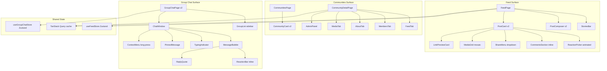
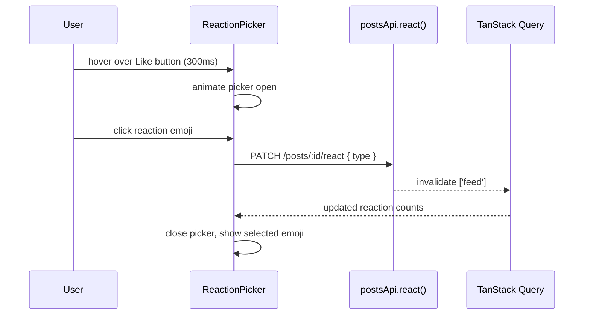
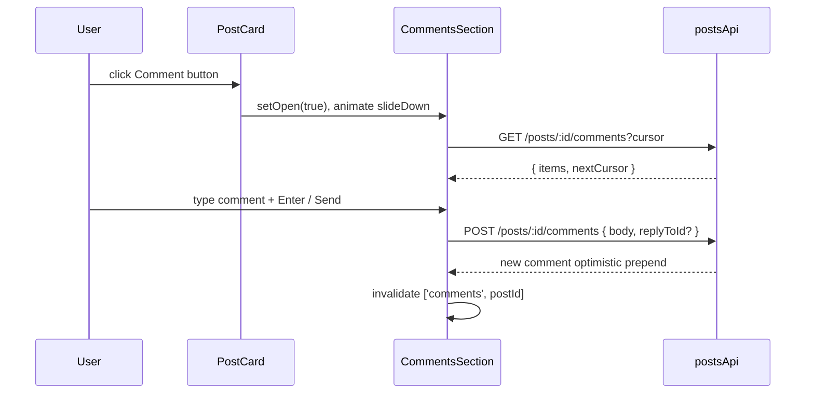
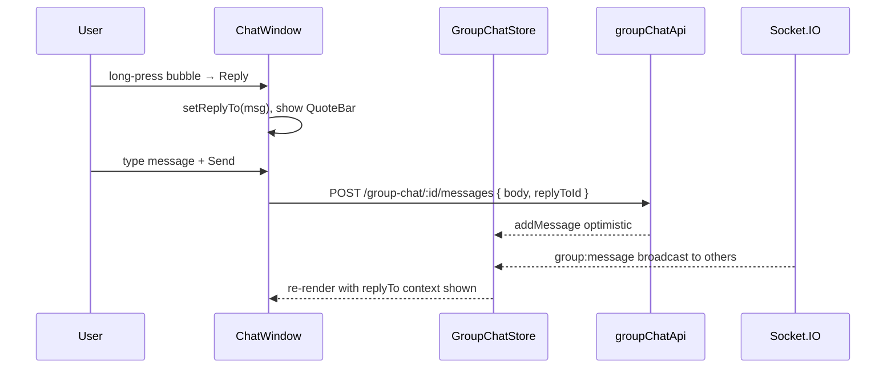

# Design Document: Social Platform UX Upgrade

## Overview

The HALQA platform's social features — Feed, Communities, and Group Chat — are being redesigned to match the UX standards of established social platforms. The Feed will mirror Facebook News Feed's interaction model (reactions, inline comments, media mosaics, link previews), Communities will adopt Facebook Groups–style tabs and admin controls, and Group Chat will adopt a Telegram-style chat bubble interface with real-time typing indicators, message reactions, reply-to threads, and read receipts.

This is a frontend-focused upgrade. The backend already exposes all required APIs and Socket.IO events. The work involves redesigning existing pages and components in the Next.js 14 / React / TypeScript / TailwindCSS stack without introducing new backend routes.

The three surface areas are independent and can be developed in parallel: `PostCard` + `FeedPage`, the Communities detail page, and the Group Chat page.

---

## Architecture



---

## Sequence Diagrams

### Feed — Reaction Flow



### Feed — Inline Comments Flow



### Group Chat — Send Message with Reply



---

## Components and Interfaces


### Component: PostCard v2

**Purpose**: Renders a single feed post with all social interactions inline. Replaces the current `CommentsModal` approach with an expandable inline comment section.

**Interface**:
```typescript
interface PostCardProps {
  post: Post
  onShare?: (post: Post) => void
  compact?: boolean
}

// New: no onComment prop — comments are inline
```

**Responsibilities**:
- Render author header (avatar, full name, timestamp, visibility badge)
- Render body text with "See more" truncation at 3 lines (line-clamp-3 + expand toggle)
- Render `@mention` and `#hashtag` as clickable links inline
- Render media via `MediaGrid` component (1 = full width, 2 = side-by-side, 3+ = mosaic)
- Render `LinkPreviewCard` when `post.linkUrl` is set
- Action bar: `ReactionPicker`, Comment toggle, `ShareMenu`, Bookmark
- Render `CommentsSection` below action bar (collapsed by default, expands in-place)

---

### Component: CommentsSection (new — inline)

**Purpose**: Replaces `CommentsModal`. Renders comment thread directly under post card, expandable without modal.

**Interface**:
```typescript
interface CommentsSectionProps {
  postId: string
  initialCount: number
  open: boolean
  onToggle: () => void
}
```

**Responsibilities**:
- Lazy-load comments only when `open === true`
- Render flat list of top-level comments, each with nested replies toggle
- Render inline reply-to highlight bar above input when replying to a comment
- Submit on Enter (shift+Enter for newline), with emoji picker trigger

---

### Component: MediaGrid (new)

**Purpose**: Renders post media attachments in the correct layout based on count.

**Interface**:
```typescript
interface MediaGridProps {
  media: PostMedia[]
  onOpen: (index: number) => void
}
```

**Responsibilities**:
- 1 item: full-width 16/9 aspect ratio
- 2 items: 50/50 side-by-side square
- 3 items: left column full-height + right column 2 stacked squares
- 4+ items: 2×2 mosaic, last cell shows `+N` overlay

---

### Component: ShareMenu (new)

**Purpose**: Dropdown with share options — Share to feed (repost), Copy link, Share to group.

**Interface**:
```typescript
interface ShareMenuProps {
  post: Post
  onClose: () => void
}
```

**Responsibilities**:
- "Share to feed" calls `postsApi.create({ type: 'REPOST', originalPostId })`
- "Copy link" uses `navigator.clipboard.writeText`
- "Share to group" opens group-picker sheet

---

### Component: PostComposer v2

**Purpose**: Upgraded post creation form with emoji picker, @mention dropdown, and location tag.

**Interface**:
```typescript
interface PostComposerProps {
  onCreated?: () => void
  placeholder?: string
  compact?: boolean
  communityId?: string
}
```

**New additions vs current**:
- Emoji picker (popover, triggered by 😊 button)
- @mention dropdown triggered by typing `@` — searches users via `/users/search`
- Location tag button (stores text label, no GPS required)


---

### Component: CommunityDetailPage v2

**Purpose**: Full redesign of the community detail page with 4 tabs: Feed, Members, About, Media.

**Interface**:
```typescript
type CommunityTab = 'feed' | 'members' | 'about' | 'media'

interface CommunityDetailState {
  activeTab: CommunityTab
  memberSearch: string
  showAdminPanel: boolean
}
```

**Responsibilities**:
- Cover photo full-bleed with overlay gradient
- Avatar badge overlapping cover bottom-left corner
- Name + member count + privacy badge + join/leave button in header row
- Tab bar: Feed | Members | About | Media
- **Feed tab**: community posts with PostCard v2 + PostComposer
- **Members tab**: searchable list with role badges (Admin, Moderator, Member), admin kick action
- **About tab**: description, rules, created-by, category
- **Media tab**: photo/video grid from community posts
- **Admin Panel** (drawer): pending join requests, pin posts, remove members

---

### Component: AdminPanel (new)

**Purpose**: Slide-in drawer for community admins/owners.

**Interface**:
```typescript
interface AdminPanelProps {
  slug: string
  onClose: () => void
}
```

**Responsibilities**:
- Fetch pending join requests via `communitiesApi.getPendingRequests(slug)`
- Accept / Decline join requests
- Display pinned posts, allow unpin
- Remove member action (with confirmation)

---

### Component: MessageBubble v2

**Purpose**: Redesigned chat bubble with full-featured context menu.

**Interface**:
```typescript
interface MessageBubbleProps {
  msg: GcMessage
  isMe: boolean
  showAvatar: boolean
  myId: string
  onReact: (msgId: string, emoji: string) => void
  onReply: (msg: GcMessage) => void
  onCopy: (text: string) => void
  onForward: (msg: GcMessage) => void
  onDelete: (msgId: string) => void
  isPinned?: boolean
}
```

**Responsibilities**:
- Sender on right (indigo bubble), others on left (white bubble)
- Avatar shown only on first message of a cluster (consecutive messages by same sender)
- Long-press (mobile) / right-click (desktop): context menu with Reply, React, Copy, Forward, Delete
- `ReplyQuote` rendered above bubble body when `msg.replyTo` is set
- Reaction pills row below bubble
- Read receipt ticks: ✓ sent, ✓✓ delivered, ✓✓ (blue) read — shown on own messages
- `isPinned` banner shown at top of chat when message is pinned

---

### Component: ContextMenu (new)

**Purpose**: Long-press / right-click context menu for message bubbles.

**Interface**:
```typescript
interface ContextMenuProps {
  position: { x: number; y: number }
  isMe: boolean
  onReply: () => void
  onReact: () => void
  onCopy: () => void
  onForward: () => void
  onDelete: () => void
  onClose: () => void
}
```

---

## Data Models

### Post (existing, with additions)

```typescript
interface Post {
  id: string
  authorId: string
  author: { id: string; firstName: string; lastName: string; avatarUrl?: string }
  type: 'POST' | 'REPOST' | 'QUOTE'
  body?: string
  visibility: 'PUBLIC' | 'FOLLOWERS' | 'PRIVATE' | 'SCHOOL_ONLY'
  media: PostMedia[]
  linkUrl?: string
  linkTitle?: string
  linkDescription?: string
  linkImage?: string
  isPinned: boolean
  shareCount: number
  location?: string           // NEW — display label for location tag
  reactions: UserReaction[]
  bookmarks: Bookmark[]
  _count: { reactions: number; comments: number }
  createdAt: string
  originalPost?: Post         // for REPOST / QUOTE
}
```

**Validation Rules**:
- `body` max 5000 characters
- `media` max 10 items
- `visibility` must be one of the 4 enum values

---

### GcMessage (existing, with additions)

```typescript
interface GcMessage {
  id: string
  conversationId: string
  senderId: string
  sender: { firstName: string; lastName: string; avatarUrl?: string }
  body?: string
  mediaUrl?: string
  mediaType?: 'IMAGE' | 'VIDEO' | 'FILE'
  replyTo?: GcMessage         // nested reply context
  reactions: { type: string; userId: string }[]
  readBy: string[]            // NEW — array of userIds who have read
  isPinned?: boolean          // NEW
  forwardedFrom?: string      // NEW — original message id if forwarded
  createdAt: string
}
```


---

## Algorithmic Pseudocode

### Algorithm: Media Grid Layout

```pascal
ALGORITHM resolveMediaLayout(mediaItems)
INPUT: mediaItems: PostMedia[]  -- length >= 1
OUTPUT: layout: MediaLayout

BEGIN
  count ← mediaItems.length

  IF count = 1 THEN
    RETURN { type: 'single', aspect: '16/9' }
  END IF

  IF count = 2 THEN
    RETURN { type: 'sideBySide', cols: 2, aspect: '1/1' }
  END IF

  IF count = 3 THEN
    RETURN {
      type: 'leftPlusStack',
      left: mediaItems[0],
      right: [mediaItems[1], mediaItems[2]],
      leftAspect: '1/1',
      rightAspect: '1/2'
    }
  END IF

  -- count >= 4: mosaic
  displayed ← mediaItems.slice(0, 4)
  overflow  ← count - 4
  RETURN { type: 'mosaic', items: displayed, overflowCount: overflow }
END
```

**Preconditions**: `mediaItems.length >= 1`
**Postconditions**: Every item in `displayed` gets exactly one cell; `overflowCount >= 0`

---

### Algorithm: "See More" Text Truncation

```pascal
ALGORITHM renderBodyText(body, expanded)
INPUT: body: string, expanded: boolean
OUTPUT: { displayText: string, showToggle: boolean }

BEGIN
  LINE_LIMIT ← 3
  lines ← body.split('\n')

  IF expanded OR lines.length <= LINE_LIMIT THEN
    RETURN { displayText: body, showToggle: lines.length > LINE_LIMIT }
  END IF

  truncated ← lines.slice(0, LINE_LIMIT).join('\n')
  RETURN { displayText: truncated + '…', showToggle: true }
END
```

**Loop Invariant**: The first `LINE_LIMIT` lines are always displayed when not expanded.

---

### Algorithm: Message Cluster Detection (Group Chat)

Groups consecutive messages by the same sender to show avatar only once per cluster.

```pascal
ALGORITHM buildMessageClusters(messages)
INPUT: messages: GcMessage[]
OUTPUT: clusters: Array<{ msg: GcMessage; showAvatar: boolean }>

BEGIN
  result ← []
  prev ← null

  FOR EACH msg IN messages DO
    isNewCluster ← (prev = null)
                    OR (msg.senderId ≠ prev.senderId)
                    OR (timeDiff(msg.createdAt, prev.createdAt) > 5 minutes)

    result.push({ msg, showAvatar: isNewCluster })
    prev ← msg
  END FOR

  RETURN result
END
```

**Postcondition**: Exactly one bubble per message; `showAvatar = true` only on the first bubble of each cluster.

---

### Algorithm: Inline Comment Section Expand / Collapse

```pascal
ALGORITHM toggleComments(postId, currentState)
INPUT: postId: string, currentState: { open: boolean; loaded: boolean }
OUTPUT: newState

BEGIN
  IF currentState.open THEN
    RETURN { open: false, loaded: currentState.loaded }
  END IF

  -- Opening for first time: trigger data fetch
  IF NOT currentState.loaded THEN
    DISPATCH fetchComments(postId)
  END IF

  RETURN { open: true, loaded: true }
END
```

**Postcondition**: Network request is made at most once per post per page load.

---

## Key Functions with Formal Specifications

### Function: `resolveReadReceipt()`

```typescript
function resolveReadReceipt(
  msg: GcMessage,
  conversationMemberIds: string[]
): 'sent' | 'delivered' | 'read'
```

**Preconditions**:
- `msg.senderId` exists in `conversationMemberIds`
- `msg.readBy` is a valid array (may be empty)

**Postconditions**:
- Returns `'read'` if all members (excluding sender) are in `msg.readBy`
- Returns `'delivered'` if at least one member (excluding sender) is in `msg.readBy`
- Returns `'sent'` otherwise
- No mutations to input parameters

---

### Function: `buildShareUrl()`

```typescript
function buildShareUrl(postId: string): string
```

**Preconditions**: `postId` is a non-empty string (CUID format)

**Postconditions**:
- Returns a fully-qualified URL: `${window.location.origin}/feed/post/${postId}`
- Deterministic: same `postId` always yields the same URL

---

### Function: `filterMentionCandidates()`

```typescript
function filterMentionCandidates(
  query: string,
  users: UserSummary[]
): UserSummary[]
```

**Preconditions**: `query` is the string after `@`, may be empty

**Postconditions**:
- If `query` is empty, returns first 5 users
- Returns users whose `firstName + lastName` contains `query` (case-insensitive)
- Returns at most 5 results
- No side effects

**Loop Invariant**: All returned candidates satisfy the filter predicate.


---

## Example Usage

### PostCard v2 — Inline Comments Toggle

```typescript
// FeedPage renders PostCard without onComment prop
<PostCard key={post.id} post={post} onShare={handleShare} />

// Inside PostCard v2 — comment toggle is self-contained
const [commentsOpen, setCommentsOpen] = useState(false)

<button onClick={() => setCommentsOpen(v => !v)}>
  <MessageCircle className="w-4 h-4" />
  <span>Comment</span>
  {post._count.comments > 0 && <span>{post._count.comments}</span>}
</button>

{commentsOpen && (
  <CommentsSection
    postId={post.id}
    initialCount={post._count.comments}
    open={commentsOpen}
    onToggle={() => setCommentsOpen(false)}
  />
)}
```

### MediaGrid — 3-item Mosaic

```typescript
// 3 media items → left tall + right 2 stacked
<div className="grid grid-cols-2 gap-0.5 rounded-xl overflow-hidden">
  <div className="row-span-2 aspect-square relative cursor-pointer" onClick={() => onOpen(0)}>
    
  </div>
  {media.slice(1, 3).map((m, i) => (
    <div key={i} className="aspect-square relative cursor-pointer" onClick={() => onOpen(i + 1)}>
      
    </div>
  ))}
</div>
```

### Group Chat — Context Menu Trigger

```typescript
// Long-press detection on bubble (mobile-friendly)
const longPressTimer = useRef<ReturnType<typeof setTimeout>>()

const handlePointerDown = () => {
  longPressTimer.current = setTimeout(() => {
    setContextMenu({ x: ..., y: ..., msgId: msg.id })
  }, 500)
}

const handlePointerUp = () => clearTimeout(longPressTimer.current)

<div onPointerDown={handlePointerDown} onPointerUp={handlePointerUp}
     onContextMenu={(e) => { e.preventDefault(); setContextMenu({ ... }) }}>
  <BubbleContent msg={msg} />
</div>

{contextMenu && (
  <ContextMenu
    position={contextMenu}
    isMe={isMe}
    onReply={() => onReply(msg)}
    onCopy={() => navigator.clipboard.writeText(msg.body ?? '')}
    onForward={() => setForwardMsg(msg)}
    onDelete={() => handleDelete(msg.id)}
    onClose={() => setContextMenu(null)}
  />
)}
```

### Community Admin Panel — Pending Requests

```typescript
const { data: pending } = useQuery({
  queryKey: ['community-pending', slug],
  queryFn: () => communitiesApi.getPendingRequests(slug).then(r => r.data.data),
  enabled: isAdmin,
})

// Accept / decline
const acceptMutation = useMutation({
  mutationFn: (userId: string) => communitiesApi.acceptRequest(slug, userId),
  onSuccess: () => queryClient.invalidateQueries({ queryKey: ['community-pending', slug] })
})
```

---

## Correctness Properties

### Property 1: Post author name is always renderable

For all posts `p` in the feed, `p.author.firstName` and `p.author.lastName` are non-empty strings, so the author header never renders a blank name.

**Validates: Requirements 1.1**

### Property 2: Media grid layout is always valid

For any `media` array of length ≥ 1, `resolveMediaLayout(media).type` is always one of `'single' | 'sideBySide' | 'leftPlusStack' | 'mosaic'` — a valid CSS layout is always applied.

**Validates: Requirements 1.2**

### Property 3: Hashtag links are rendered for all hashtag tokens

If `post.body` contains any token matching `/^#\w+/`, at least one `<Link>` element pointing to `/explore/hashtag/...` is rendered in the post body.

**Validates: Requirements 1.3**

### Property 4: Feed deduplication is guaranteed

For all `incomingPosts` prepended via Socket.IO, the deduplication filter ensures no `post.id` appears more than once in `allPosts`.

**Validates: Requirements 1.4**

### Property 5: "All caught up" state condition is exact

The "You're all caught up" end-of-feed message is rendered if and only if `!hasNextPage && allPosts.length > 0`.

**Validates: Requirements 1.5**

### Property 6: Join button is hidden for invite-only communities

For any community where `privacy === 'INVITE_ONLY'`, the join/leave button is never rendered regardless of membership state.

**Validates: Requirements 2.1**

### Property 7: Admin Panel is gated to admins and owners

For any community where `myRole !== 'OWNER' && myRole !== 'ADMIN'`, the Admin Panel trigger button is not present in the DOM.

**Validates: Requirements 2.2**

### Property 8: Members tab search is case-insensitive and complete

For every member `m` returned by the Members tab search, `(m.user.firstName + ' ' + m.user.lastName).toLowerCase()` contains the search query string (lowercased). No member satisfying the predicate is omitted.

**Validates: Requirements 2.3**

### Property 9: Message cluster count matches message count

For any input `messages` array, `buildMessageClusters(messages).length === messages.length` — every message maps to exactly one cluster entry.

**Validates: Requirements 3.1**

### Property 10: Read receipt is accurate for own messages

For own messages, `resolveReadReceipt(msg, memberIds)` returns `'read'` if and only if every member id (excluding the sender) is present in `msg.readBy`.

**Validates: Requirements 3.2**

### Property 11: Context menu is a singleton

At most one context menu is visible at any time — only one `contextMenu` state value is non-null across the entire chat window.

**Validates: Requirements 3.3**

### Property 12: Reply-to state is cleared after send

After a successful message send, `replyTo` is always set to `null` in the success handler, regardless of the message content or API response body.

**Validates: Requirements 3.4**

### Property 13: Typing indicators exclude self

Typing indicator names are derived only from members whose `userId !== currentUser.id`, so the current user never sees their own typing indicator.

**Validates: Requirements 3.5**

---

## Error Handling

### Feed Error Scenarios

| Scenario | Response | Recovery |
|----------|----------|----------|
| Feed API fetch fails | Show inline error state with retry button | Re-trigger `fetchNextPage` on button click |
| Reaction mutation fails | Toast: "Failed to react" | Optimistic state is rolled back by TanStack Query |
| Media upload fails in composer | Toast: "Upload failed" | File input cleared; user can retry |
| Post creation fails | Toast: "Failed to post"; body text preserved | User can retry without re-typing |

### Communities Error Scenarios

| Scenario | Response | Recovery |
|----------|----------|----------|
| Join request fails (private community) | Toast with API error message | Button re-enabled |
| Admin kick member fails | Toast: "Failed to remove member" | No member removed; list unchanged |
| Pending requests fetch fails | Silently show empty list | Retry on panel reopen |

### Group Chat Error Scenarios

| Scenario | Response | Recovery |
|----------|----------|----------|
| Send message fails | Toast: "Failed to send"; input text restored | User can retry |
| Reaction fails | Silently ignored (no optimistic update) | User can re-tap |
| Load older messages fails | Toast: "Failed to load history" | "Load more" button remains enabled |
| Leave group fails | Toast: "Failed to leave group" | User remains in group |

---

## Testing Strategy

### Unit Testing Approach

Focus on pure helper functions and component rendering:
- `resolveMediaLayout(media)` with 1, 2, 3, 4, 5 items
- `buildMessageClusters(messages)` with same-sender clusters, time gaps > 5 min
- `resolveReadReceipt(msg, memberIds)` across all 3 states
- `filterMentionCandidates(query, users)` with edge cases (empty query, no matches, >5 results)
- `renderBodyText(body, expanded)` with 1-line, 3-line, 5-line bodies
- `PostCard` snapshot renders with pinned, REPOST, QUOTE post types

### Property-Based Testing Approach

**Property Test Library**: fast-check

Key properties to verify:
- For any `media` array of length 1–10, `resolveMediaLayout` always returns a defined, valid layout type
- For any list of `messages`, `buildMessageClusters(messages).length === messages.length`
- For any `body` string, `renderBodyText(body, false).displayText.length <= renderBodyText(body, true).displayText.length`
- For any `postId` string, `buildShareUrl(postId)` always returns a URL starting with `https://` or `http://`

### Integration Testing Approach

- Feed infinite scroll: mock IntersectionObserver, verify `fetchNextPage` is called on sentinel visibility
- Socket.IO feed events: mock socket, emit `post:create` from another user, verify banner appears; emit own post, verify no banner
- Community join/leave flow: mock API, verify button text and `myRole` state updates
- Group Chat send + reply flow: submit with `replyTo` set, verify API called with `replyToId`, verify `replyTo` cleared after success

---

## Performance Considerations

- **Virtual scrolling**: The feed and group chat message lists should use `react-window` or similar if message count exceeds ~200 items. For initial release, standard DOM rendering with infinite scroll pagination (50 items/page) is acceptable.
- **Image lazy loading**: All `` tags in `MediaGrid` and `CommunityCard` use `loading="lazy"`.
- **Reaction picker**: The animated picker is rendered in a portal (`document.body`) to avoid layout thrashing inside scrollable containers.
- **Typing indicator debounce**: Emit `typing_start` at most once per 2.5-second window (already implemented in GroupChatPage).
- **Comment section lazy fetch**: Comments are fetched only when the section is first opened, not on initial PostCard render.
- **TanStack Query stale time**: Community detail queries use `staleTime: 60_000` to avoid redundant refetches when switching tabs.

---

## Security Considerations

- **Media URLs**: All `resolveMediaUrl()` calls are used before rendering — no raw user-supplied URLs are injected into `src` attributes.
- **XSS in post body**: Body text is rendered as plain text (`whitespace-pre-wrap`). Hashtag/mention parsing splits on whitespace tokens and wraps with `<Link>` — no `dangerouslySetInnerHTML` is used.
- **Admin actions**: Admin Panel components gate render on `isOwnerOrAdmin` boolean derived from server-returned `myRole` — the server enforces authorization; the frontend gate is UX-only.
- **Forward message**: Forwarded message content is treated as read-only display text; the forward API creates a new message record server-side.
- **Context menu delete**: Destructive message delete is only available for `isMe === true` messages; confirmed by checking `msg.senderId === user.id` on render.

---

## Dependencies

All dependencies already installed in the project:

| Dependency | Version | Usage |
|------------|---------|-------|
| `next` | 14.x | App router, pages |
| `react` | 18.x | UI components |
| `@tanstack/react-query` | 5.x | Server state, infinite scroll |
| `zustand` | 4.x | Client state (feed store, group chat store) |
| `tailwindcss` | 3.x | Styling |
| `socket.io-client` | 4.x | Real-time events |
| `framer-motion` | 10.x | Bubble animations, picker animations |
| `date-fns` | 3.x | Timestamp formatting |
| `lucide-react` | latest | Icons |

**No new npm dependencies are required.** The emoji picker can be implemented as a Tailwind-styled grid of emoji characters (subset: smileys, hearts, common expressions) to avoid adding a heavy third-party library.
